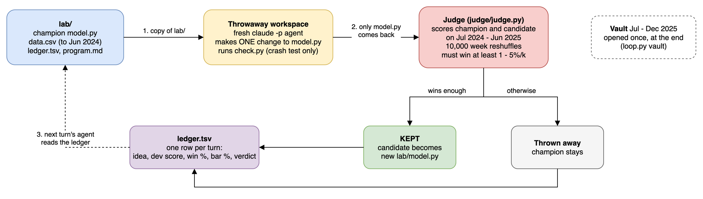
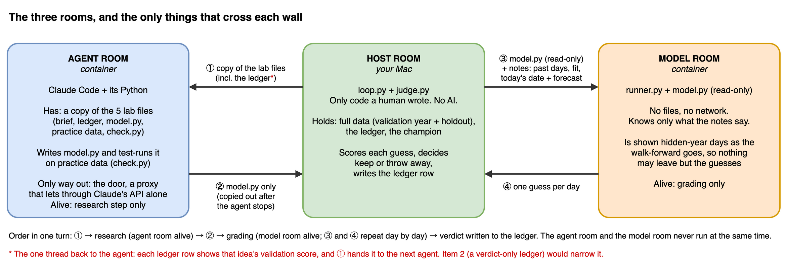

# Toy autoresearch: a fake town's electricity use

The smallest working version of an agent research loop, with guards against overfitting.

    lab/        the only things the agent sees: program.md (your brief), model.py,
                data.csv (Jan 2023 - Jun 2024), ledger.tsv, check.py
    judge/      the frozen judge, the full data and the vault
    loop.py     each turn: fresh workspace -> fresh agent makes one change ->
                judge compares -> keep or throw away -> ledger
    history/    every model the agent wrote, plus its reply and cost per turn
    rooms/      the locked rooms (Docker containers), see "The three rooms" below:
                model-room     where judge.py runs model.py: no internet, no files but model.py
                agent-room     where the agent works: it sees only the turn's workspace
                agent-door     the agent room's only way out: a proxy that lets through Claude's API alone
    scripts/    helpers outside the main loop:
                test_rooms.py  proves the rooms' walls hold (about 30 seconds)
                make_data.py   rebuilds the fake town (seeded, so you get the same data)
                night_sim.py   simulates whole nights of 300 ideas and checks every keep against the truth
                bundle_sim.py  tests whether small changes add up when submitted together
    docs/       the diagrams below

## One turn of the loop

The diagram is a `.drawio.png`: it displays as an image and also opens for editing in draw.io.

## Who sees which months

    Jan-Jun 2023   Jul 2023-Jun 2024   Jul 2024-Jun 2025    Jul-Dec 2025
    warm-up        agent's practice    judge's exam (dev)   vault
    <------ agent has these ------->   agent never sees     opened once, at the end

Every score walks forward a month at a time: the model is trained on everything before
the month, then predicts each day of it. So July 2024 is predicted from 18 months of
history, June 2025 from 29.

## Run it

Needs Docker Desktop (running) and Claude Code.

    pip install numpy pandas scipy
    python loop.py build          # build the rooms (run and vault also do this first)
    python scripts/test_rooms.py  # check that the walls hold (about 30 seconds)
    claude setup-token            # once: a login token the agent room can use
    export CLAUDE_CODE_OAUTH_TOKEN=<the token it prints>
    python loop.py run 5          # five agent turns
    python loop.py vault          # open the vault once, at the end
    python loop.py reset          # start over from the baseline
    python scripts/night_sim.py   # the overnight experiment, no agent needed (about 5 minutes)

The ledger and history/ in this folder are from the example run below (agent: Claude Sonnet
via `claude -p`; change the model in loop.py). `python loop.py reset` clears them.

## The example run (average miss per day, MWh; lower is better)

    turn  idea                                        dev    won    needed  verdict      vault
    0     average of the last 7 days                  5.78   -      -       start        5.82
    1     weekday + heating/cooling regression        2.92   100%   95%     KEPT         2.75
    2     model log(load) instead of load             2.94   10%    97.5%   thrown away
    3     add yesterday's temperatures                2.89   68%    98.3%   thrown away
    4     move thresholds to 18 / 22 C                2.98   9%     98.8%   thrown away
    5     correct with yesterday's error              2.91   62%    99%     thrown away
          answer key (the exact recipe)               2.83                                2.77

Checked afterwards on 50 parallel towns: turns 2, 4 and 5 were truly no better, so the
judge was right. Turn 3 was truly better by 0.04 MWh, but one scored year was too small
to prove it, so both the old and the new rule threw it out. Small exams miss small gains.

## What night_sim.py found (10 nights of 300 ideas each, MWh)

"Flukes" are kept changes that made the true error worse. "Ledger" is how much the
scored-year miss shrank; "truth" is how much the true miss shrank (100 parallel towns).

                       starting from turn 2's model     starting from the best model
                       flukes   ledger   truth           flukes   ledger   truth
    old toy            9.3      +0.45    +0.22           12.2     +0.21    -0.03
    hide answers only  0.7      +0.30    +0.23           2.0      +0.07    -0.01
    rising bar only    0.6      +0.22    +0.17           0        0        0
    both (this toy)    0        +0.24    +0.20           0        0        0

## The keep rule

The judge re-deals the 52 scored weeks 10,000 times (some weeks twice, some not at all)
and keeps a change only if it has the lower average miss in nearly all of the re-deals.
The bar rises with every idea tested: the 1st must win 95%, the 10th 99.5%, the 100th 99.95%.
Added up over a whole night, that keeps the expected number of lucky keeps below one.
Whole weeks are re-dealt together because neighbouring days share weather.

## Three guards against overfitting

1. The agent never has the answers for the year it's graded on, so it can't tune on it.
2. The bar rises with the number of tries, so a long night can't win by sheer volume.
3. The vault is opened once. If you change things because of what it says, it becomes
   another dev set, so then you need fresh months to check on.

## The three rooms

Walls, not instructions, keep the agent's code away from the answers:

- **The host** (your Mac) runs only code a human wrote, `loop.py` and `judge.py`, and holds
  all the data, the vault included.
- **The agent room** is a container that sees only the turn's workspace. Its network has one
  way out, the door: a proxy that lets through Claude's API and refuses everything else. The
  agent's web tools are off, and only a plain `model.py` comes back from the room.
- **The model room** is where the judge runs `model.py`: a container with no internet, no
  writable files, and nothing from your Mac except `model.py` itself, read-only. The judge
  passes it notes, one line of JSON at a time, and reveals each day's load only after the
  model has guessed it.

Before the rooms, the judge ran `model.py` in its own process, so a 6-line model could read
today's answer from the judge's variables. It was kept, and the vault agreed with it.
`python scripts/test_rooms.py` now runs four such cheats and checks that each one crashes.

The door stays up after a run. Its log lists every request the agent sent through it, until
the next run or test run starts a fresh door. Attempts to go around the door simply fail,
and leave no trace there.

    docker exec toy-agent-door cat /var/log/squid/access.log

What the rooms don't fix: the ledger still shows the agent each rejected idea's dev score,
and Docker is a strong fence for an over-eager agent, not a guarantee against hostile code.
