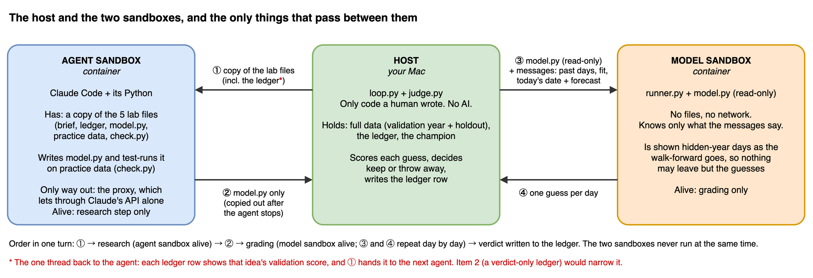
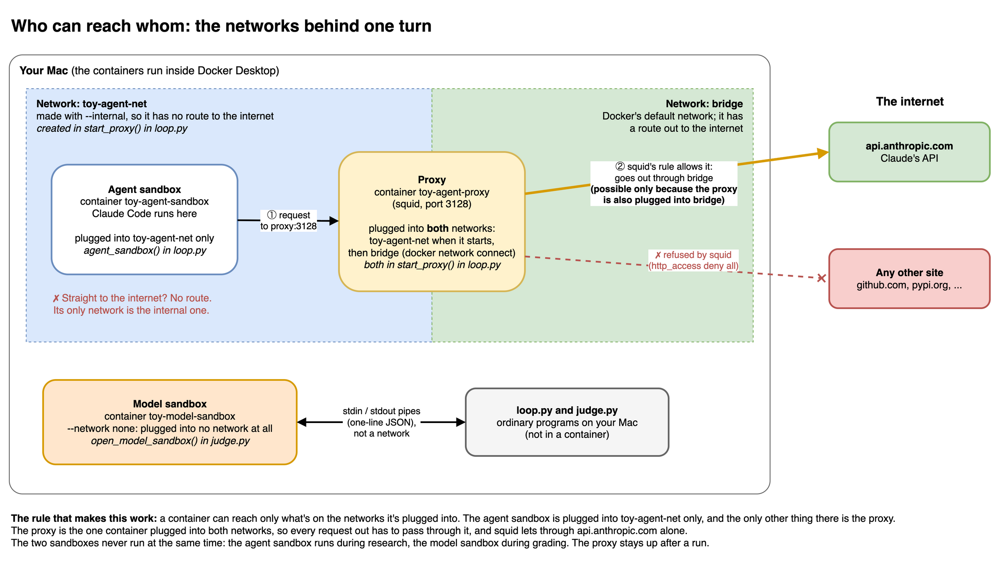

# Toy autoresearch: a fake town's electricity use

The smallest working version of an agent research loop, with guards against overfitting.

    lab/        the only things the agent sees: program.md (your brief), model.py,
                data.csv (Jan 2023 - Jun 2024), check.py, practice.py (scores a change on
                the practice year), ledger.tsv (the agent's copy of the ledger)
    judge/      the frozen judge, the full data and the holdout
    loop.py     each turn: fresh workspace -> fresh agent makes one change -> the loop
                measures it on the practice year -> judge compares -> keep or throw away -> ledgers
    ledger.tsv  the full ledger, validation scores included; the agent never sees it
    history/    every model the agent wrote, plus Claude Code's whole response for the turn
                (the reply and the cost, or the errors if the run failed)
    docker/     the two sandboxes and the proxy (Docker images), see "Isolation" below:
                model-sandbox  where judge.py runs model.py: no internet, no files but model.py
                agent-sandbox  where the agent works: it sees only the turn's workspace
                agent-proxy    the agent sandbox's only way out: it lets through Claude's API alone
    scripts/    helpers outside the main loop:
                test_sandboxes.py  proves the isolation holds (about 30 seconds)
                test_loop.py       proves each kind of turn is logged as promised (about 1 minute)
                make_data.py       rebuilds the fake town (seeded, so you get the same data)
                night_sim.py       simulates whole nights of 300 ideas and checks every keep against the truth
                bundle_sim.py      tests whether small changes add up when submitted together
    docs/       the diagrams below

## One turn of the loop

The diagram is a `.drawio.png`: it displays as an image and also opens for editing in draw.io.

## Who sees which months

    Jan-Jun 2023   Jul 2023-Jun 2024   Jul 2024-Jun 2025    Jul-Dec 2025
    training       agent's practice    judge's validation   holdout
    <------ agent has these ------->   agent never sees     scored once, at the end

Every score walks forward a month at a time: the model is trained on everything before
the month, then predicts each day of it. So July 2024 is predicted from 18 months of
history, June 2025 from 29.

## Run it

Needs Docker Desktop (running), Claude Code and [uv](https://docs.astral.sh/uv/).

    uv sync                           # once: Python 3.12 and the locked packages, into .venv
    uv run loop.py build              # build the Docker images (run and holdout also do this first)
    uv run scripts/test_sandboxes.py  # check that the isolation holds (about 30 seconds)
    uv run scripts/test_loop.py       # check the loop's verdicts and ledgers, with a stand-in agent (about 1 minute)
    claude setup-token                # once: a login token the agent sandbox can use
    export CLAUDE_CODE_OAUTH_TOKEN=<the token it prints>
    uv run loop.py run 5              # five agent turns
    uv run loop.py holdout            # score the holdout once, at the end
    uv run loop.py reset              # start over from the baseline
    uv run scripts/night_sim.py       # the overnight experiment, no agent needed (about 5 minutes)

The ledgers and history/ in this folder are from the example run below (agent: Claude Sonnet
via `claude -p`; change the model in loop.py). `uv run loop.py reset` clears them.

## The example run (average miss per day, MWh; lower is better)

                                                  practice year      validation year
    turn  idea                                    miss   won     miss   won    needed  verdict              holdout
    0     average of the last 7 days              5.66   -       5.78   -      -       start                5.82
    1     weekday + heating/cooling regression    3.04   100%    2.92   100%   95%     KEPT                 2.75
    2     model log(load) instead of load         3.03   66%     2.94   10%    97.5%   thrown away
    3     add yesterday's temperatures            2.88   99.9%   2.89   68%    98.3%   thrown away
    4     move thresholds to 18 / 22 C            3.01   66%     2.98   9%     98.8%   thrown away
    5     correct with yesterday's error          3.04   19%     2.91   62%    99%     thrown away
    6     add yearly sine/cosine terms            3.09   10%     2.92   29%    99.2%   thrown away
    7     fit by least absolute deviations        -      -       -      -      -       dropped on practice
    8     add squared heating/cooling degrees     3.21   2%      -      -      -       dropped on practice
          answer key (the exact recipe)                          2.83                                       2.77

"Won" is the share of 10,000 reshuffles of the year's weeks in which the idea beat the
champion of the time. The practice columns were measured afterwards, for turns 0-6.

Checked afterwards on 50 parallel towns: turns 2, 4 and 5 were truly no better, so the
judge was right. Turn 3 was truly better by 0.04 MWh, but one scored year was too small
to prove it, so both the old and the new rule threw it out. Small exams miss small gains.
On the practice year, turn 3 is the only one of turns 2-6 to win more than 90% of the
reshuffles, which is where program.md's guideline for submitting comes from.
Turns 6 and 7 came later, inside the sandboxes (see "Isolation"). Turn 7 found its idea
worse on the practice year (3.19 against 3.04, by its own scorer) and dropped it, so it
didn't count as a try. It also copied the champion back, so that idea's code is lost.
Turn 8 was the first with practice.py and the structured reply: the loop measured its idea
at 2% of practice reshuffles, the same numbers the agent reported, and it wasn't submitted.

## Two ledgers

Every turn adds a row to the full ledger, `ledger.tsv`, which stays on the host. The agent's
copy, `lab/ledger.tsv`, is rewritten from it after every turn without the validation columns:

    full ledger    turn, idea, practice_champion, practice, practice_wins,
                   val_mae, win_pct, bar_pct, verdict, lesson, reply_check
    agent's copy   turn, idea, practice_champion, practice, practice_wins, verdict, lesson

The agent sees practice numbers, which come from a year it already has, and the judge's
verdict. If it also saw validation scores, it could pick and combine near-misses by them,
which is tuning on the judge's year one row at a time (finding 6 in CLAUDE.md).

The loop measures the practice numbers itself, with the model in the model sandbox, so
they don't depend on what the agent reports. The agent finishes each turn with a structured
reply (its idea, a lesson, the numbers `practice.py` printed, and whether to submit), which
the loop checks against a JSON schema. `reply_check` records whether the agent's practice
numbers match the loop's: `ok`, `practice mismatch`, `not run` (the agent reported none), or
`-` when the loop had nothing to compare them with.

    verdict              when                                                        a try?
    KEPT                 judged, and cleared the bar                                 yes
    thrown away          judged, and didn't clear it                                 yes
    dropped on practice  model.py changed, but the agent chose not to submit it      no
    no change            model.py is identical to the champion                       no
    crashed              model.py failed in the loop's practice run or the judge's   no
    invalid reply        no valid structured reply; practice is still measured       no
    start                the baseline row                                            no

Only a try raises the bar.

## What night_sim.py found (10 nights of 300 ideas each, MWh)

"Flukes" are kept changes that made the true error worse. "Ledger" is how much the
scored-year miss shrank; "truth" is how much the true miss shrank (100 parallel towns).

                       starting from turn 2's model     starting from the best model
                       flukes   ledger   truth           flukes   ledger   truth
    old toy            9.3      +0.45    +0.22           12.2     +0.21    -0.03
    hide answers only  0.7      +0.30    +0.23           2.0      +0.07    -0.01
    rising bar only    0.6      +0.22    +0.17           0        0        0
    both (this toy)    0        +0.24    +0.20           0        0        0

## The keep rule

The judge re-deals the 52 scored weeks 10,000 times (some weeks twice, some not at all)
and keeps a change only if it has the lower average miss in nearly all of the re-deals.
The bar rises with every idea tested: the 1st must win 95%, the 10th 99.5%, the 100th 99.95%.
Added up over a whole night, that keeps the expected number of lucky keeps below one.
Whole weeks are re-dealt together because neighbouring days share weather.

## Three guards against overfitting

1. The agent never has the answers for the year it's graded on, so it can't tune on it.
2. The bar rises with the number of tries, so a long night can't win by sheer volume.
3. The holdout is scored once. If you change things because of what it says, it becomes
   another validation set, so then you need fresh months to check on.

## Isolation

Isolation, not instructions, keeps the agent's code away from the answers:

- **The host** (your Mac) runs only code a human wrote, `loop.py` and `judge.py`, and holds
  all the data, the holdout included.
- **The agent sandbox** is a container that sees only the turn's workspace. Its network has
  one way out, the proxy, which lets through Claude's API and refuses everything else. The
  agent's web tools are off, and only a plain `model.py` comes back from the sandbox.
- **The model sandbox** is where the judge runs `model.py`: a container with no internet, no
  writable files, and nothing from your Mac except `model.py` itself, read-only. The judge
  sends it messages, one line of JSON at a time, and reveals each day's load only after the
  model has guessed it.

The networks behind this: a container can reach only what's on the networks it's plugged
into. The agent sandbox is plugged into one internal network, whose only other member is the
proxy. The proxy is also plugged into Docker's default network, which leads to the internet.
`HTTPS_PROXY` tells Claude Code to send its requests to the proxy; anything that ignores it
finds no route out.

Before the sandboxes, the judge ran `model.py` in its own process, so a 6-line model could
read today's answer from the judge's variables. It was kept, and the holdout agreed with it.
`uv run scripts/test_sandboxes.py` now runs four such cheats and checks that each one crashes.

The proxy stays up after a run. Its log lists every request the agent sent through it, until
the next run or test run starts a fresh proxy. Attempts to go around the proxy simply fail,
and leave no trace there.

    docker exec toy-agent-proxy cat /var/log/squid/access.log

What the sandboxes don't fix: Docker is a strong fence for an over-eager agent, not a
guarantee against hostile code. And each verdict still tells the agent one thing about the
judge's year: whether that idea cleared the bar.
